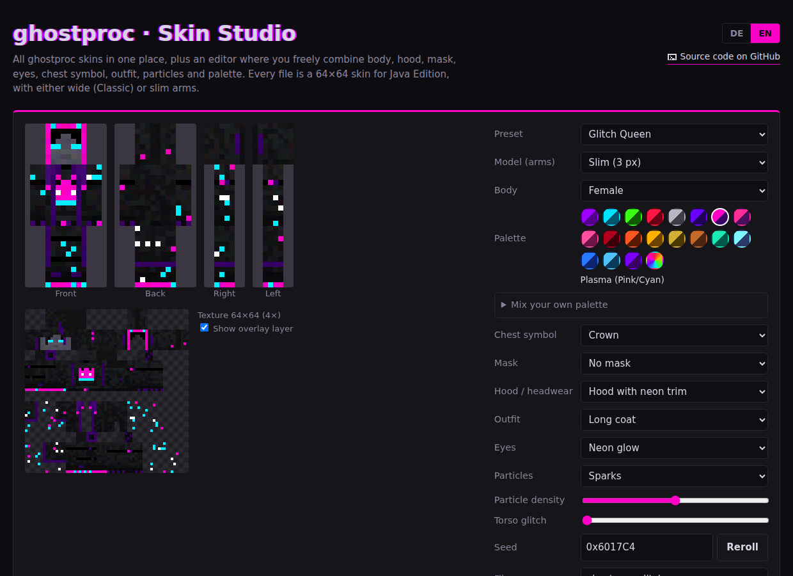
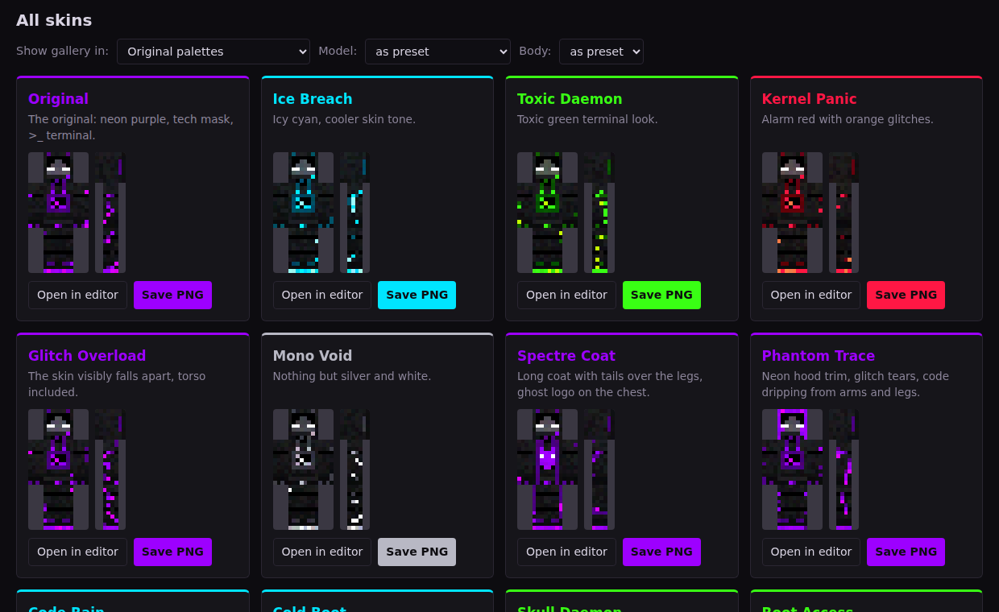

# ghostproc · Skin Studio

**[▶ Open the Skin Studio](https://daniofficial.github.io/ghostproc-Skin-Studio/)** · [English](#english) · [Deutsch](#deutsch)

A browser-based skin studio for Minecraft: Java Edition. Mix hoods, masks, eyes, outfits, chest symbols and particles, choose wide or slim arms and a male or female body, recolor everything in 19 palettes and save the result as a 64×64 PNG.

---

## English

### Features

- **32 presets** in a gallery, each one downloadable with a single click
- **Wide or slim:** every skin works with the Classic model (4 px arms) or the Slim model (3 px arms)
- **Male or female body:** the female body adds long hair, eyelashes and a defined waist
- **19 color palettes** plus a custom palette with six freely mixable colors
- **Seed-based:** the same seed and settings always produce the exact same skin
- **English and German** interface, switchable at any time
- **A single HTML file:** no install, no external libraries, no tracking, no server

### Everything you can combine

| Category | Count | Options |
| --- | --- | --- |
| Chest symbol | 15 | `>_` Terminal, Ghost, Skull, Binary, Eye, Heart, Lightning bolt, Lambda, Hash, Bug, Warning sign, Padlock, Crescent moon, Crown, none |
| Mask | 11 | Tech, Breather, Glitch, Gas mask, Bandana, LED grin, Bone jaw, Fangs, Pixel censor, Stitched mouth, none |
| Hood / headwear | 9 | Deep hood, Neon trim, Racing stripe, Circuit board, Cat ears, Horns, Hood down, Beanie, none |
| Outfit | 8 | Hoodie, Long coat, Harness, Tech vest, Cyber armor, Scarf, Tracksuit, Lab coat |
| Eyes | 9 | White staring, Glitch tears, Neon, Glowing red, Iris, Visor band, Glitched, Cyclops, Void |
| Particles | 9 | Dissolve, Code drip, Matrix rain, Sparks, Neon flames, Scanlines, Data blocks, Neon aura, none |

### How to use your skin

1. Open the [Skin Studio](https://daniofficial.github.io/ghostproc-Skin-Studio/).
2. Pick a preset from the gallery or build your own in the editor, then click **Save PNG**.
3. In the Minecraft Launcher, select **Minecraft: Java Edition** and open the **Skins** tab.
4. Add a new skin, choose the PNG and set the matching player model: **Classic** for wide arms, **Slim** for slim arms.

> If the model doesn't match the file, the arms show gaps or look cut off.

**Tip:** Append `?lang=en` or `?lang=de` to the URL to open the studio directly in a specific language.

### Run it locally

Download `index.html` and open it in any modern browser. Nothing else is needed, it also works offline.

### License

© 2026 DaniOfficial. This project is licensed under **[CC BY-NC 4.0](https://creativecommons.org/licenses/by-nc/4.0/)** (see [LICENSE](LICENSE)).

- ✅ You may use, share and modify it for **non-commercial** purposes.
- ❌ **Commercial use is not permitted.**
- ✍️ If you share it or publish a modified version, you must **credit DaniOfficial**, link to [this repository](https://github.com/DaniOfficial/ghostproc-Skin-Studio), link to the license and state what you changed.

Using skins made with the studio on your own Minecraft account is of course fine.

---

## Deutsch

### Funktionen

- **32 Vorlagen** in einer Galerie, jede mit einem Klick herunterladbar
- **Breit oder schmal:** Jeder Skin funktioniert mit dem Modell „Klassisch" (4-px-Arme) oder „Schlank" (3-px-Arme)
- **Männliche oder weibliche Figur:** Die weibliche Figur hat lange Haare, Wimpern und eine schmalere Taille
- **19 Farbpaletten** plus eine eigene Palette mit sechs frei mischbaren Farben
- **Seed-basiert:** Gleicher Seed und gleiche Einstellungen ergeben immer exakt denselben Skin
- Oberfläche auf **Deutsch und Englisch**, jederzeit umschaltbar
- **Eine einzige HTML-Datei:** keine Installation, keine externen Bibliotheken, kein Tracking, kein Server

### Alles, was du kombinieren kannst

| Kategorie | Anzahl | Optionen |
| --- | --- | --- |
| Brust-Symbol | 15 | `>_` Terminal, Geist, Totenkopf, Binär, Auge, Herz, Blitz, Lambda, Raute, Bug, Warnschild, Vorhängeschloss, Sichelmond, Krone, keins |
| Maske | 11 | Tech, Atemmaske, Glitch, Gasmaske, Bandana, LED-Grinsen, Knochen-Kiefer, Reißzähne, Pixel-Zensur, zugenähter Mund, keine |
| Kapuze / Mütze | 9 | Tiefe Kapuze, Neon-Rand, Rennstreifen, Leiterbahnen, Katzenohren, Hörner, abgelegt, Strickmütze, ohne |
| Outfit | 8 | Hoodie, Langer Mantel, Harness, Tech-Weste, Cyber-Panzer, Schal, Trainingsanzug, Laborkittel |
| Augen | 9 | Weiß starrend, Glitch-Tränen, Neon, rot glühend, Iris, Visier-Band, Glitch, Zyklop, leer |
| Partikel | 9 | Auflösen, Code-Tropfen, Matrix-Regen, Funken, Neon-Flammen, Scanlines, Datenblöcke, Neon-Aura, keine |

### So nutzt du deinen Skin

1. Das [Skin Studio](https://daniofficial.github.io/ghostproc-Skin-Studio/) öffnen.
2. Eine Vorlage aus der Galerie wählen oder im Editor einen eigenen Skin bauen, dann auf **PNG speichern** klicken.
3. Im Minecraft Launcher **Minecraft: Java Edition** wählen und den Reiter **Skins** öffnen.
4. Einen neuen Skin anlegen, die PNG auswählen und das passende Spielermodell einstellen: **Klassisch** für breite Arme, **Schlank** für schmale Arme.

> Passt das Modell nicht zur Datei, haben die Arme Lücken oder wirken abgeschnitten.

**Tipp:** Mit `?lang=de` oder `?lang=en` hinter der Adresse öffnet sich das Studio direkt in der gewünschten Sprache.

### Lokal starten

`index.html` herunterladen und in einem aktuellen Browser öffnen. Mehr braucht es nicht, das funktioniert auch offline.

### Lizenz

© 2026 DaniOfficial. Dieses Projekt steht unter der Lizenz **[CC BY-NC 4.0](https://creativecommons.org/licenses/by-nc/4.0/deed.de)** (siehe [LICENSE](LICENSE)).

- ✅ Du darfst es für **nicht-kommerzielle** Zwecke nutzen, teilen und verändern.
- ❌ **Kommerzielle Nutzung ist nicht erlaubt.**
- ✍️ Wenn du es weitergibst oder eine veränderte Version veröffentlichst, musst du **DaniOfficial nennen**, auf [dieses Repository](https://github.com/DaniOfficial/ghostproc-Skin-Studio) verlinken, auf die Lizenz verweisen und angeben, was du geändert hast.

Skins aus dem Studio für deinen eigenen Minecraft-Account zu verwenden, ist natürlich erlaubt.

---

*Not an official Minecraft product. Not approved by or associated with Mojang or Microsoft.*
*Kein offizielles Minecraft-Produkt. Nicht von Mojang oder Microsoft genehmigt oder mit ihnen verbunden.*
